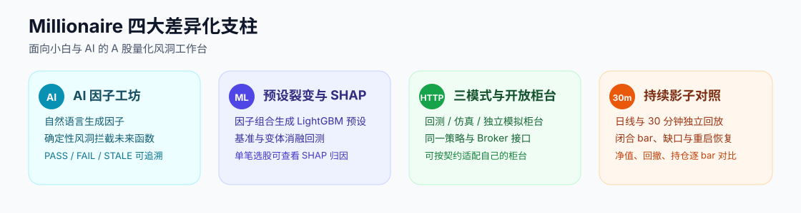

# Millionaire

**面向小白与 AI 的 A 股量化风洞工作台。** 用自然语言研究因子，用确定性检查拦住未来函数，再把通过检验的策略放进回测、仿真、独立 HTTP 模拟柜台和持续影子对照。采用 MIT 许可证。



Millionaire 是社区版与专业版的合称；本仓库是社区版（CE），包名和命令均为 `millionaire`，Python 导入名为 `quantide`。专业版专属功能明确称为 **millionaire pro**。CE 不开放真实交易；millionaire pro 或用户宿主扩展可装配真实券商适配器。

## 四大差异化支柱

1. **AI 因子工坊 + 确定性风洞。** 在 Web `/factors/studio` 用自然语言描述因子，AI 按受控工具链写插件；风洞随后检查未来数据扰动、跨证券隔离、确定性、预热契约和人工样本，坏因子被拦截并回喂首个差异。源码、配置或数据指纹变化后，旧结论降级为 `STALE`，不能继续冒充通过。
2. **因子预设裂变 LightGBM + 单笔 SHAP。** 把通过检验的因子组合保存为预设，一键生成基准/变体消融回测；内置日线 LightGBM 示例复用训练、选股、调仓与预测解释，可追到某一次决策里各因子的贡献。CE 不内置三重障碍、回撤卖出、成本止损或持仓缓冲带等 pro/用户私有策略。
3. **回测 / 仿真 / 独立 HTTP 模拟柜台三模式一致，柜台开放。** 策略通过统一 Broker 接口工作，固定行情、费用和撮合假设下可对拍现金、持仓、成交与费用。HTTP 把策略与柜台进程分开，用户可按契约适配券商，也可让 AI 辅助编写并用模拟柜台验证。
4. **日线 / 30 分钟 Shadow-Run 持续对照。** 仿真实例按实时行情推进，影子实例按策略周期独立回放；30 分钟使用 8 个闭合槽位，记录跨 bar、跨午休、跨日 T+1 和缺口回补，在 `/tracking/<账户ID>` 对比净值、回撤、持仓和缺口状态。

## 3 分钟免 Token 快速体验

不需要 Tushare token，也不要求先写代码：

1. [下载并安装](docs/native-installation.md) macOS ARM64、Ubuntu x86_64 或 Windows x64 原生包，或在源码目录运行 `python3.13 scripts/install.py --ml30m`。
2. 启动 `millionaire --open`，在初始化向导中一键启用约 3.8 MB 的合成体验数据包；它只用于离线演示研究、回测和 SHAP 链路，不代表真实市场结论。
3. 打开因子研究或第一次回测，查看 Rank IC、分层收益、LightGBM 与 SHAP；再转入仿真，观察日线或 30 分钟影子对照。

AI 助手配置是 `OPTIONAL`：跳过它仍可使用 Demo、回测、因子分析和审计。需要自然语言写因子时，再接入 OpenAI 兼容服务或本地模型；API key 在页面、日志和导出中脱敏。

## 能力定位对比

下表只列各项目的主要侧重点，便于选择起点，不构成完整评测或优劣排名；具体能力请以各自版本文档为准。

| 维度 | Millionaire CE | Backtrader | VeighNa | Qlib |
| --- | --- | --- | --- | --- |
| 主要定位 | A 股量化工作台：AI 因子、风洞、投研与持续对照 | Python 事件驱动回测与交易框架 | 面向国内交易与 CTP/期货等场景的事件驱动平台 | AI 量化研究平台，强调因子/模型流水线 |
| A 股数据与交易规则 | 内置 SQEP 数据边界、T+1、涨跌停、固定周期与缺口门禁 | 通过数据/ broker 扩展接入 | 提供国内柜台与交易网关生态 | 侧重研究数据与模型，运行时需结合其他组件 |
| AI 生成因子与确定性检查 | 内置 AI 因子工坊、外部插件、风洞五态徽章与指纹失效 | 通常由用户自行搭建 | 通常由用户自行搭建 | 侧重模型研究，非本仓库同款因子沙箱 |
| LightGBM 与决策归因 | 预设裂变、消融回测、SHAP 单笔解释 | 需自行组合 | 需自行组合 | 提供研究与模型工具链 |
| 回测 / 仿真 / 独立 HTTP 柜台 | 三种模式统一 Broker，并可开放适配柜台 | 以回测/交易适配为主 | 以交易网关与实盘接入为主 | 以研究/回测流水线为主 |
| 持续影子对照 | 日线与 30 分钟 Shadow-Run，含缺口与重启恢复 | 需自行实现 | 需自行实现 | 需自行实现 |

## 从这里开始

1. [了解本版能力和边界](docs/scope.md)。
2. [下载并安装](docs/native-installation.md)，支持 macOS ARM64、Ubuntu x86_64、Windows x64。
3. [初始化与数据准备](docs/initialization.md)，设置管理员密码和可选数据源。
4. [完成第一次回测](docs/backtesting.md)，阅读报告，再[转入仿真](docs/paper-trading.md)。
5. 用 AI 写因子时，阅读[AI 辅助开发](docs/ai-development.md)；自行接数据/柜台时，阅读[行情扩展](docs/quote-extensions.md)和[柜台适配](docs/broker-adapters.md)。

[在线文档](https://zillionare.github.io/millionaire/)随默认分支发布；功能开发分支的文档可能尚未部署。如果站点仍显示旧版，可直接在 GitHub 仓库阅读 [`docs/`](docs/)（GitHub 会渲染 Markdown），或在源码目录运行 `mkdocs serve` 离线查看。站点不依赖第三方字体或脚本资源，代理环境不应出现渲染挂起。安装包以 [GitHub Releases](https://github.com/zillionare/millionaire/releases) 实际列出的产物为准，旧版本的 Release 不代表已包含本分支的新安装器。

## 安装后

原生包自带 Python 和固定版本依赖。Windows 使用图形安装向导，macOS/Ubuntu 通过命令行安装；安装后由操作系统管理后台服务。macOS 自动显示菜单栏 **M** 控件，Windows 自动显示系统托盘控件，两者均随登录启动，可启停服务并打开浏览器。Ubuntu 桌面提供窗口式控制器。未签名安装包的校验与系统放行步骤见[原生安装](docs/native-installation.md#先校验再放行)。

退出控件不会停止后台服务；退出后可以重新打开：

```bash
millionaire control
```

默认网页地址为 `http://127.0.0.1:8130`。首次启动进入 wizard，没有默认管理员密码。Linux 系统服务的启停命令需要 sudo；Windows 会在需要时请求管理员权限。

## 实时行情和版本范围

初始化先检查所选历史数据源：Tushare 需要 token 与对应接口权限，BaoStock 日线免 token；也可一键启用约 3.8 MB 的合成体验数据包，离线验证研究、回测和 SHAP 链路。已有可接入的官方实时快照权限时自动选用，跳过演示配置。全部配置完成后，单独确认并开始历史数据下载。

腾讯演示行情**默认关闭**，wizard 可显式启用一次固定 **30 天**演示。关闭、重启、升级均不续期，到期自动关闭；后续通过自己的[行情扩展](docs/quote-extensions.md)接入。历史数据下载与该实时行情选项相互独立。

CE 不内置三重障碍、回撤卖出、成本止损或私有风险程序，风险程序注册表默认是空的。源码树提供 SHAP 预测解释、账户事实[收益归因](docs/prediction-explanation.md)和离线[策略/因子审计](docs/strategy-audit.md)；它们不是收益保证，也不是对所有策略/柜台的完全安全证明。30 分钟影子按闭合 bar 回放；数据源能力矩阵等后续方向见[版本状态](docs/roadmap.md)。

## 开发与贡献

包名是 `millionaire`，Python 导入名为 `quantide`。源码开发要求 Python 3.13：

```bash
python3.13 scripts/install.py --ml30m
.venv/bin/millionaire --open
```

Windows 使用 `py -3.13 scripts\install.py --ml30m`；激活虚拟环境后可直接调用命令。完整步骤、源码专用的离线 stub、质量预算与 CI 门禁见[源码安装](docs/installation.md)、[开发者验收](docs/developer-acceptance.md)和[质量管理](docs/quality.md)。

仓库布局、临时构建/报告路径及推荐的模块命令见[开发目录约定](docs/project-layout.md)。
