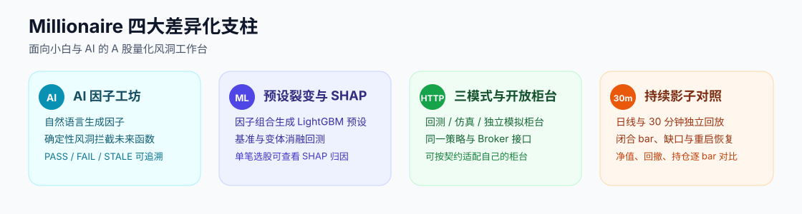

# Millionaire 用户手册

Millionaire 是**面向小白与 AI 的 A 股量化风洞工作台**。它提供数据底座、回测、撮合、仿真、独立 HTTP 模拟柜台和确定性风洞机制：用自然语言写因子，先通过风洞检查，再进入回测、仿真和持续影子对照。

Millionaire 共有两个版本：社区版（CE，开源，即你现在看到的版本）和专业版（**Millionaire pro**）。CE 提供回测、进程内仿真和独立模拟柜台；真实交易由 **Millionaire pro** 或用户宿主扩展接入。

## 四大差异化支柱

1. **AI 因子工坊 + 确定性风洞**：Web `/factors/studio` 用自然语言生成单文件因子，风洞检查未来数据扰动、跨证券隔离、确定性、预热契约与人工样本；源码、配置或数据指纹变化后徽章降级为 `STALE`。
2. **因子预设裂变 LightGBM + 单笔 SHAP**：通过检验的因子组合可保存为预设并生成基准/变体消融回测；内置日线 LightGBM 示例提供选股、调仓和单次决策的 SHAP 归因。
3. **三模式一致与开放柜台**：回测、仿真和独立 HTTP 模拟柜台复用统一 Broker 接口；用户可按契约适配自己的柜台，并用模拟柜台验证。
4. **日线 / 30 分钟 Shadow-Run**：仿真实例按当前行情运行，影子实例按策略周期独立回放；30 分钟使用闭合 bar，记录缺口、T+1 和重启恢复，在对照页展示净值、回撤、持仓与逐 bar 明细。

## 3 分钟免 Token 体验

安装并启动后，在初始化向导中一键启用约 3.8 MB 的合成体验数据包，即可不使用 Tushare token 走通因子研究、回测、LightGBM 和 SHAP 链路。体验包不提供实时行情；只做研究和回测时不受影响。AI 助手配置是可选项，跳过它仍可使用上述功能；需要自然语言写因子时再接入 OpenAI 兼容服务或本地模型。

## 核心能力

**策略在回测、仿真和实盘间无感切换** Millionaire 把交易和撮合从策略逻辑中剥离出来，使用统一的 Broker 接口，再通过适配器提供不同运行模式下的交易、撮合实现。遵循框架接口的策略沿用同一份交易逻辑，切换模式时无需改写策略代码。社区版已提供回测、进程内仿真和[独立模拟柜台服务](simulated-counter.md)，可在无券商环境下完整演练跨进程 HTTP 委托、撮合与重启对账；真实交易由 **Millionaire pro** 或用户宿主扩展接入。

**不锁定券商** 实盘接口的门槛和接入标准始终在变。Millionaire 提供统一的 HTTP 交易接口，将柜台与策略进程分开，你可以根据券商实际开放的接口自行适配柜台；即使不熟悉编程，也可让 AI 依据接口、参考实现和验收用例协助完成。社区版提供适配边界和模拟柜台，真实账户接入由 **Millionaire pro** 或用户宿主扩展装配。详见[柜台适配指南](broker-adapters.md)。

**不锁定数据源** 适配器将供应商数据转换为统一字段、时间和单位：历史数据进入标准存储，实时行情进入行情 Hub。项目内的这套数据约定称为 SQEP（标准行情交换协议）。接入新数据源从编写适配器开始，AI 也可以依据接口和样例协助完成。详见[标准行情交换协议](SQEP.md)。

**可靠的数据底座与缺口门禁** 历史数据采集偶有中断或缺失时，框架支持断点续传并优先补齐近期数据。每次回测启动前会自动核对目标区间的数据覆盖度：一旦发现关键行情缺失就明确拦截并提示，绝不在残缺数据上静默跑出失真的净值曲线。

**策略防呆和防作弊** AI 生成或人工编写策略时，最容易混入未来函数、违反交易规则或错配运行周期（例如把按日线设计的逻辑误放到分钟级运行）。框架从底层统一接管成交时序、T+1、涨跌停、资金校验与运行周期绑定，从机制上拦截违例操作与隐性作弊，避免“回测很美、一上实盘就走样”。（涨跌停检查依赖有效的限价数据。）详见[成交时序与策略防呆](execution.md)。

**完备的投研与决策归因闭环** Millionaire 打通了因子检验、模型训练、选股调仓、参数优化、风控叠加、离线审计与归因分析的完整投研链路，并内置基于 LightGBM 的多因子机器学习参考流程。除了常规的账户收益归因，框架还提供一般量化框架少见的 **SHAP 预测解释（决策归因）**，让黑盒模型每一次选股和调仓都能追查到具体的因子贡献。详见[因子研究](factor-analysis.md)、[因子与 LightGBM](factors-and-ml.md)、[策略与因子审计](strategy-audit.md)与[预测解释与收益归因](prediction-explanation.md)。

**主策略与风控策略独立设计** 风控程序只需创建一次，就可以与多个主策略叠加。Millionaire 提供风险程序注册、兼容性检查、优先级及回测/仿真生命周期；用户注册适配器后，即可选择自己的风控程序。**Millionaire pro** 内置多个风控程序，包括基于三重障碍法的止盈止损风控。详见[风险扩展契约](design/risk_program_selection.md)。

**尾盘竞价模式** 对日线策略，Millionaire 支持 Cheat-on-Close 模型：回测按当日收盘模型撮合，仿真在收盘前依据当时可见行情计算并提交委托。模型前提见[成交时序](execution.md)。

**对照运行（Shadow-Run）** 策略投入持续运行时，Millionaire 自动开启双实例对照运行模式：一边按实时行情推进交易（社区版为仿真盘，**Millionaire pro** 支持实盘），另一边用同一策略和配置按回测方式在每个周期完结、历史行情就绪后独立回放。通过对照两个账户的净值、回撤与每日差额，可以更清晰地分辨策略表现偏离究竟源于“盘中执行与回测假设之间的 gap”，还是市场风格发生了转换。使用入口见[仿真与影子对照](paper-trading.md#shadow-run)。

## 推荐阅读顺序

| 你现在要做什么    | 入口                                                                                                           |
| ----------------- | -------------------------------------------------------------------------------------------------------------- |
| 第一次使用        | [快速开始](quickstart.md) → [安装](native-installation.md) → [初始化](initialization.md)                       |
| 验证策略想法      | [第一次回测](backtesting.md) → [成交时序和防呆](execution.md)                                                  |
| 开发策略或因子    | [编写策略](strategies.md) → [因子与 LightGBM](factors-and-ml.md)                                               |
| 研究和比较结果    | [因子研究](factor-analysis.md) → [参数优化](optimization.md) → [预测解释与收益归因](prediction-explanation.md) |
| 连续运行          | [仿真](paper-trading.md) → [启停、升级与恢复](operations.md)                                                   |
| 自行接入数据/柜台 | [行情扩展](quote-extensions.md) → [柜台适配](broker-adapters.md)                                               |
| 核对证据与质量    | [策略与因子审计](strategy-audit.md) → [质量门禁](quality.md)                                                   |
| 遇到问题          | [常见问题](troubleshooting.md)                                                                                 |

## 阅读前确认

Millionaire 支持 macOS Apple Silicon（ARM64）、Ubuntu x86_64 和 Windows x64；原生包自带 Python 与固定版本依赖。是否已经发布对应安装包，以 [GitHub Releases](https://github.com/zillionare/Millionaire/releases) 的实际文件为准。

Millionaire 社区版已经为实盘做好架构与验证准备，但不内置真实交易下单通道；真实账户接入需通过 **Millionaire pro** 或自行适配柜台扩展完成。

Millionaire 不在分发包中附带真实历史行情，但内置 Tushare 与 BaoStock 接口；BaoStock 日线无需 token。初始化还可启用约 3.8 MB 的合成体验数据包，免 token 演示因子研究、回测和 SHAP 链路，不能用于真实市场结论。

Millionaire 的仿真交易功能需要实时行情数据。为便于体验，系统内置了基于腾讯财经的临时演示源（默认关闭，可启用一次，30 天后自动到期关闭）；到期后请接入自己的实时行情扩展。更多信息见[版本状态与后续方向](roadmap.md)和[本版能力与版本状态](scope.md)。
